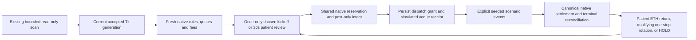

# CoinCat v1.01 — all-market automated maker PAPER trial

This source build integrates the durable paper engine with accepted normal scans.
It has seven actual-product tabs and fourteen directional views, one funded
simulated portfolio, frozen patient/short-lived maker policies and a seeded stress venue.
Source base: v100 commit ebe4fd7405dc7a827503b090ef60af348c45d838, fetched and
matched before this work. The owner requested publication as v1.01 after checks.
No running-PC installation, account change or live order is authorized.

## Windows trial

1. Extract into a separate new source folder, preserving the working installation,
   private records and backups. Never overlay a running version or share a data
   folder between running installations. Follow START_HERE for an independent
   verified dataset copy; fresh financial setup needs an empty destination and
   its existing explicit confirmation. Nothing here resets an old ledger.
2. Run `02_SETUP_COINCAT.bat` and `03_VERIFY_COINCAT.bat` with Windows Python 3.11.
   Require matching source hashes and no failures/errors. Inspect skips. The
   owner's earlier v100 Windows run had 307 tests, zero failures/errors, one
   host-symlink skip and a Tcl theme-cleanup warning; it does not verify v1.01.
   The first v1.01 Windows run took 1278.366 seconds and reported two invalid
   test-fixture folder names plus the host-symlink skip. The follow-up uses
   portable names; a clean native rerun is still required. Source hash PASS
   alone is not suite acceptance. The verifier now shows numbered test names,
   elapsed times and a 30-second heartbeat, including discovery/cleanup.
   Windows verification can take 20 minutes or more; the final result and
   COUNTS line determine success. Keep any ERROR tracebacks and slowest timings.
3. Run `tools\RUN_PAPER_REPLAY.bat`. It needs no account and must retain the
   declared fixture result: two terminal orders, four simulated fills, zero real
   orders, zero verified exchange fills, two fictitious SOL. It is a replay proof.
4. Start CoinCat v1.01 and use the existing read-only Connect / refresh. Keep the
   existing local credential, permissions, DPAPI and single-instance gates. No
   new credentials or permissions are needed. Review/apply working ETH and its
   manual/protected/excluded carve-outs in Allocation.
5. Open **Auto Paper Trader**. Its opt-in is off. Default paper allocation is
   10% of fresh working ETH; choose 5–25% or an exact custom ETH slice. This
   funds the whole paper portfolio once, not seven independent wallets. It
   cannot exceed the working proposal or use account BTC/companion balances.
6. In **Session settings**, review the kickoff, provider/model/seed, original
   horizon, fee ceiling/stress and review/cooldown limits. Default kickoff is
   ETH→BTC, the actual ETH-BTC post-only SELL, with no prediction/best-market
   claim or automatic fallback. Other explicit choices are ETH→SOL/LINK/ADA.
7. Inspect each of the seven product tabs and its two direction tabs. Source
   funding, product eligibility, BUY/SELL, native units, candidates, reservations,
   fee assumptions, order state and waiting reasons stay local. The book shows
   actual observed best bid/ask; sized depth is UNKNOWN. Selecting a tab creates
   no quote request, wallet, seed or order.
8. Check **Auto-Start Maker Rotation — PAPER ONLY**, then press **Start Auto
   Paper Trader**. This explicit session action freezes the settings and starts
   the existing scan workflow, without requiring the manual research plan.
   The first qualifying frame attempts exactly one small chosen kickoff. A
   blocked product, stale fee/quote or native minimum shows a blocker. Spend is
   never raised to meet a minimum. There is no requirement for a profitable cycle
   forecast before kickoff, and no substitute seed after an unfilled attempt.
9. Observe simulated PENDING_NEW/OPEN/PARTIAL/terminal states. Partial source
   and proceeds stay locked until terminal settlement with known fees. Only a
   confirmed simulated receipt enables a funded successor. No order appears on
   Coinbase. The seed can remain wholly unfilled for the entire session.
10. Try **Pause paper**, **STOP**, and clean close. Pause/STOP prevent new intents
    and preserve inventory/reservations. Already determined simulated receipts
    and cancel races can still settle; STOP is neither a sale nor cancellation
    confirmation. Close cancels read work and waits responsively for its worker
    and bounded public quote batch to finish before destroying Tk.
11. Reopen. A saved checkbox never resumes trading or creates another seed.
    Expect RECONCILIATION_REQUIRED. **Reconcile paper** verifies the simulated
    provider's recorded balances, native receipts, identities, known fees and
    all nonterminal orders, then leaves PAUSED. Press Start separately. Original
    deadlines, budget, kickoff identity, parameters and limits remain unchanged.
12. Inspect **History** and each direction's **Local paper events**. New paper
    session is an explicit separate evaluation and baseline; prior databases,
    open exposure and losses are retained. No session totals are pooled as capital.
    Share the redacted eight-section diagnostics or monitor v3 snapshot, not the
    private paper files or monitor token directory.

Native Windows/DPI/DPAPI/single-instance, connected fee/product availability and
60–120-minute supervised acceptance still need that PC's evidence. Source tests
and Linux Tk captures do not establish installation readiness or profitable fills.

## Short-lived orders with a fresh decision

The owner requested that a limit quote be valid only briefly while pursuing ETH
accumulation. For a **new** paper session, choose **Session settings → Order
policy → Short-lived / net ETH target** before opt-in/Start. Patient target
remains the default for compatibility. Existing sessions keep their frozen
policy, funding and original expiry; updating the source cannot silently change
an existing experiment. New paper session retains the prior database, holdings,
open orders and losses as a separate study, with no pooled capital or transfer.

| Short-lived control | Default | Valid range |
|---|---|---|
| Order lifetime | 120 seconds | 60–600 seconds |
| Minimum rest before a price-move cancel | 30 seconds | At least 30s, shorter than order lifetime |
| Reprice threshold | 10 bps and at least two native ticks | 1–100 bps; two-tick floor |
| Review / new-order cooldown | Existing 30s / 30s | Existing validated settings |
| Session orders / open orders | Existing 16 / 1 | Every replacement consumes a slot; hard bounds unchanged |

The controller reads only accepted fresh normal scans. BUY uses the actual
resting bid minus its offset; SELL uses the actual ask plus its offset, with
native rounding/post-only admission. Minimum rest starts at venue acceptance,
not local creation or pending arrival. A meaningful move after minimum rest can
request cancellation. Otherwise the order keeps its queue identity until the
short lifetime ends. Expiry requests cancellation of the unfilled portion; it
is not a sale, fill or cancellation acknowledgment. Both source and partial
proceeds stay locked until terminal reconciliation with known fees.

After cancellation, the next eligible review uses a new fresh frame, not a cached
replacement price. A wholly unfilled kickoff can retry only the same chosen
direction and remaining approved source budget, under the same persisted
kickoff campaign. It never allocates initial ETH again or substitutes another
market. Once any seed receipt is confirmed and terminal, the funded inventory
drives the normal one-step selector. An ETH return is placed at the current
resting price only if its modeled after-fee native receipt meets the original
allocated net ETH target. Otherwise the view says
HOLD_MARKET_BELOW_NET_ETH_TARGET. It does not lower the target to force a sale
or leave a far-away profit exit resting for a day. Held coins and marked losses
remain visible; short order life does not ensure recovery or eventual ETH gains.

Each replacement inherits its original campaign deadline, remaining budget and
the session's original expiry. A two-minute child order does not renew the
24-hour session or the direction's maximum waiting window. Reaching the order
budget pauses new placement with PAPER_ORDER_BUDGET_EXHAUSTED_HOLD_INVENTORY.
Sixteen two-minute attempts total 32 minutes resting, plus cancel/review delays;
price-move cancellations can use the budget sooner. Raising the allowed order
count is never automatic. No blind reallocation/new session circumvents a limit.

The existing feed scans five seconds after each bounded pass (up to six seconds
collection), rather than providing tick-level streaming. Expiry/reviews are
processed when observations resume after a gap; deadlines themselves never
renew. STOP/restart rules remain unchanged. Replacements lose the old modeled
queue position and repeat arrival/rest/queue checks. Short lifetimes can sharply
reduce fills, and a series of no-fills is an honest result. Neither touching a
price nor the passage of 120 seconds creates an execution or fee.

For ordinary Coinbase Advanced spot orders, canceling an entirely unfilled
limit order normally carries no execution fee; fees on filled portions remain.
Current Coinbase fee/help pages could not be refreshed from this environment.
The paper model still uses explicit simulated quote fees, not verified exchange
fee units. No actual cancellation endpoint or account order is used here.

The versioned policy is SHORT_LIVED_ETH_V1. The original
PATIENT_MAKER_ETH_V1 configuration serialization and behavior remain available.
Inspect order age/lifetime remaining, policy reason and slot counts locally.
The settings dialog scrolls, with Close always reachable. Monitor v3 exports
only the known policy enum and safe aggregates, without TTL, prices, seeds,
campaign identities or private holdings.

Run the unchanged synthetic holdout with the new policy explicitly selected:

```text
.venv\Scripts\python.exe -B tools\AUTO_PAPER_HOLDOUT.py --synthetic --policy SHORT_LIVED_ETH_V1
```

Prices, model parameters, seeds and horizons remain the same predeclared fixture.
Do not loosen queue/fill assumptions to make short-lived orders execute. These
results and native Windows results for the preceding 353-test verifier are
reported separately from this source candidate in VERIFICATION.txt.

## Frozen defaults and limits

| Setting | Initial choice | Reason |
|---|---|---|
| Automatic paper opt-in | Off | No startup funding or orders without explicit session Start |
| Initial paper ETH | 10% of working ETH; 5–25% or exact custom | Small bounded hypothetical slice after existing carve-outs |
| Kickoff | ETH→BTC / ETH-BTC / SELL | Simple named startup choice, no predictor or fallback |
| Policy | PATIENT_MAKER_ETH_V1 | Seek configured net ETH target; HOLD is valid |
| Enabled directions | All 14 views | Runtime listing, permissions, exclusions and funding still govern |
| Per-direction source cap | 100% of available paper source within native ceiling | One shared funded slice, no per-view duplicated capital |
| Net ETH target | 0.25% | Conditional target, not forecast or guaranteed return |
| Entry offset | 0 bps | Actual resting bid for BUY / ask for SELL |
| Order wait / original session horizon | 24h / 24h | Expiry prevents new placements and handles cancels, never liquidation |
| Review / cooldown | 30s / 30s | Review can retain an order; no extra quote cadence or blind churn |
| Open / session orders | 1 / 16 | Lower operational limits inside the engine's hard bounds |
| Model / seed | CONSERVATIVE_STRESS_V1 / 1 | Reproducible declared stress assumptions, uncalibrated |
| Maker fee ceiling / added stress | 2% / 5 bps | Size inside a worst supported fee reserve; retain fresh account evidence |
| Membership label | Coinbase One Basic | No assumed Advanced rebate or simple-trade fee waiver |

The first ETH native cap equals the approved paper slice. When a funded intent
first acquires a new asset, its first canonical planned net receipt freezes that
asset's maximum native per-order source cap before dispatch. This never credits
funds or increases an existing cap. Receipts can leave native dust or excess units
outside the per-order cap; those remain visible and cannot be labeled ETH profit.
The cap rule, exact native ceilings, expiry, counts and fee ceiling persist.

Hard guards remain 64 session orders, 16 open orders, 512 retained fills, 4096
execution events, 512 KiB encoded state/payload and 32 MiB storage. A guard stops
safely without deleting evidence. Configuration uses the lower one-open/16-order
defaults. Observation-only context checkpoints replace one bounded cache row;
they cannot change funds or consume/delete the execution journal. Up to 2048
minute detail samples are retained, then explicitly marked truncated; latest
aggregates and the immutable horizon still update while storage permits.

## Policy and shared decision path



The controller receives only the current pass's frozen frame after GUI generation
acceptance. The worker and tabs have no paper order authority. The existing four
ETH anchors plus two rotating BTC cross-pairs retain six research/16 total books,
four workers, 0.2-second GET spacing, six-second collection deadline, 30-second
quote age, 0.25% spread and 12-second dependency span. No additional market GET,
polling loop or inverse product is introduced. Deferred books can be displayed
with their old age; they cannot supply a new combined decision.

Kickoff bypasses any cycle-profit ranking, while retaining every admission gate.
After a terminal positive receipt, the selector considers direct ETH return and
eligible directions from the asset actually held. A patient ETH return limit
uses the original simulated ETH reference allocated to that inventory, its target
and canonical native rounding. This reference bookkeeping is not a financial
lot/tax-basis system. All native debits/credits come from engine settlement.

A competing one-step direction must exceed its configured same-frame conditional
ETH cost/return threshold. Its destination's ETH numeraire is a conditional
maker-price comparison, not a forecast of several later trades or proof of
liquidation. Direct ETH return has priority when its current conditional price
meets the target; otherwise a qualifying rotation can take priority over a far
patient return. Ties use fixed priority, score and direction ID. No candidate
qualifying means HOLD, including holding ETH after a completed return. There is
no blind continuous seed loop to create activity.

An open reasonable order remains through ordinary reviews. Only a fresh superior
conditional rotation justifies canceling a resting patient return. Cancel must
settle before reevaluating/replacing; stale proposed replacements are not reused,
and their original replacement window is retained. A far patient return that
expires is not blindly reposted; a fresh qualifying reason is required.
Partial orders and pending cancels stay locked. Original order/session deadlines
never renew across gaps, retries, tab changes or restart. Expiry never triggers
a market/taker order, forced sale or liquidation of underwater inventory.

## Provider assumptions and fee evidence

The current collector supplies BBO without sized depth, observed queue position
or adequate trade flow. The selected safe implementation uses explicit versioned
seeded stress scenarios inside the original data budget. It is not a reconstructed
matching engine or calibrated maker fill probability. Synthetic queue capacity
is never presented as observed volume/depth or written into quote charts.

Every supported model requires a simulated arrival delay of at least two seconds
and a fresh post-only check at arrival. A marketable intent is rejected. A fill
also requires strictly through-limit quotes, at least three distinct observations
spanning ten seconds, a minimum resting period, synthetic queue depletion and a
seeded execution gate. Mere touching/equality never fills. Prices execute at the
original limit rather than an invented favorable improvement. Missing/wide/stale
evidence pauses generation; observation gaps reset sustained-cross evidence.
Legitimate deferred passes within 30 seconds do not invent an observation.

| Model | Rest | Seeded gate | Maximum partial | Fee stress multiplier |
|---|---:|---:|---:|---:|
| NO_FILL_V1 | 30s | 0 | none | 1 |
| CONSERVATIVE_STRESS_V1 | 30s | 0.2 | 25% | 1 |
| PARTIAL_SCARCE_V1 | 60s | 0.1 | 10% | 1 |
| ADVERSE_SLOW_V1 | 60s | 0.1 | 10% | 1.5 |

Initial synthetic queue ahead is 2–4 times the order size; capacity per eligible
observation is at most half that size, determined by a stable SHA256-seeded draw.
The table's gate is an assumption, not an estimate of exchange fill likelihood.
All model parameters/seed and policy settings are recorded before trading and
cannot change inside a session. Source/model changes require explicit review.
Scheduled explicit fill/cancel events persist and settle in time order, with
final fill winning a cancel race and no automatic repeat of a dispatch grant.

Account maker/taker rates must be fresh through the existing authenticated
read-only tier path. Hourly refresh, two-hour TTL and at least ten-minute failed
retry remain. No per-order fee request, missing-rate fallback, zero-fee default
or membership rebate is introduced. The simulated venue explicitly charges
quote-currency fees from those supported rates plus declared stress, rounded up to the native
quote increment and constrained by the
ceiling; elevated modeled fees above the ceiling pause for review. This defines
simulation units, not authenticated Coinbase pair applicability or fee currency.
Actual pair exceptions and fee debit currency remain unverified and block a
credible after-cost valuation. Unknown/unsupported fill fees quarantine funds
under the existing engine rules. Rebates and other fee assets stay unsupported.
Subscription cost is excluded from execution fees and separately disclosed as
unmodeled. No plan selector can change fee evidence.

## Performance and holdout evidence

The same original paper ETH and same horizon define HOLD. Realized paper ΔETH,
native holdings, midpoint marked ETH, conditional recoverable ETH, native fees,
partial/non-fills, reserved/idle funds, observed underwater time, drawdown and
missing coverage remain distinct. Midpoint changes include open losses and are
not executable proceeds. Drawdown measures the fall from the highest observed
midpoint portfolio value, including gains above the initial ETH baseline.
Underwater time is measured against ETH HOLD. Unobserved intervals do not become
continuous coverage.
Missing sized exits, synchronized dependencies, fee units or residue valuation
keeps recoverable ETH UNKNOWN. Actual account profit always stays NOT ESTABLISHED.

The first observation at/after the original horizon is final inside 30 seconds.
Later favorable prices cannot rewrite it; missing evidence is UNKNOWN_AT_HORIZON
and a late observation is MISSED_HORIZON. Later cancel/fill cleanup remains in
the operational record, separate from the frozen evaluation result.

Run the explicitly synthetic stress comparison with:

```text
.venv\Scripts\python.exe -B tools\AUTO_PAPER_HOLDOUT.py --synthetic
```

Its development prefix and untouched chronological holdout, model parameters,
prices, seeds and favorable/adverse scenarios are predeclared. It reports all
seeds/models, including no-fills, partials and underwater holdings, without tuning
or future-price selection. This checks evaluation/lifecycle contracts only. It
is not historical or forward market evidence and establishes no predictive edge.
Actual counts/results and platform limits are in VERIFICATION.txt and the
delivered logs. See AUTO_PAPER_FEEDBACK.md for objections and live-pilot blockers.

**Paper only. No demonstrated edge or guaranteed profit. Maker orders may never
fill. Wholly unfilled orders normally incur no execution fee; partials incur
supported fees and change exposure. Reserved funds, opportunity cost and holding
risk remain. Resting orders may later fill unfavorably. Paper gains are simulated
and never account profit.**
