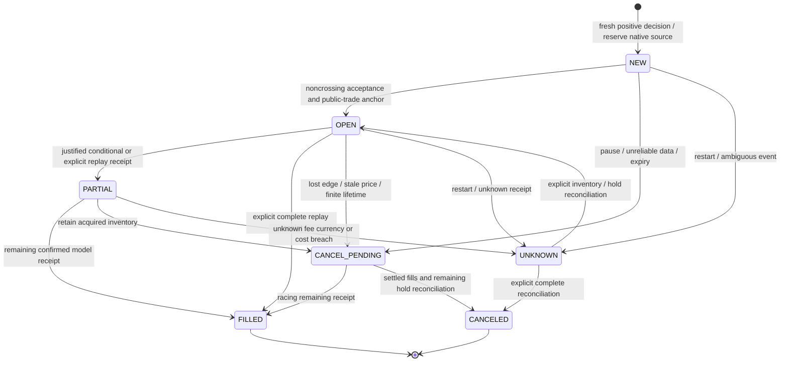

# CoinCat v1.05 — retained 24-hour baseline policy and evidence

This describes the retained direct-24h trial. The [multi-horizon follow-up](MULTI_HORIZON_V1_05.md) adds a separate trial and progress views without migrating this baseline. See the [Windows update guide](../START_HERE.md) to preserve existing state.

## Objective and funding

Maximize risk-adjusted projected total USD portfolio value net of the proposed leg's own costs; measure observed modeled performance against unchanged original quantities of BTC, ETH, SOL, LINK and ADA. The owner selected ACCOUNT_AVAILABLE as default: first Start requires a fresh permission-scoped account snapshot, copies available balances once (holds already excluded), and freezes original quantities/marks. Missing watched balances mean zero, not invented funds. FICTIONAL_100_EACH is an optional pre-start alternative. No real funds move. Account-scope change requires review.

The new path is `research_data/intelligent_v105/active.sqlite3`; hourly reference history is separate. Never migrate/reset an existing v1.04 trial into this policy. Risk settings and provider freeze. Default maximum source fraction 0.5, concentration weight 0.6, volatility-risk weight 1, empirical uncertainty multiplier 2.58 and concentration penalty 0.02. These are research controls, not proven confidence levels or real funding grants. No fixed USD spending/profit floor, forced return or automatic liquidation.

## Direct rolling 24-hour forecast

Five USD products supply valuation and closed hourly histories solely as references. Only the seven native products are order markets. Require 2,400 aligned observations (100 days), 72h features, positive finite prices, consecutive hourly UTC times, bounded changes, no future bar and at most 3,720s feature age. Current native/reference consistency, freshness, spread and asynchronous decision-span checks remain.

`DIRECT_24H_ANALOG_V1` predicts actual 24h forward returns. Features per asset: observed 24h return, 72h return and RMS hourly volatility over 24h. Labels start at daily UTC origins, with each outcome completed before a later prediction. At least 40 daily training labels; twelve nearest analogs; scaling computed from each training fold only. Last fourteen chronological days are holdout, preceded by fourteen validation days; each prediction trains only on labels already matured at its origin. The holdout observations are never used to fit their own prediction. No hyperparameter search is performed on them. Current estimation may use all outcomes matured by the current decision, with parameters fixed before observation.

Record training/feature endpoints, parameters, history SHA256, analog origins, fold counts, forecast/naive momentum/HOLD MAEs, covariance and residual error/bias. Feature outliers above eight training standard deviations, extreme hourly/daily returns, current-price shocks or insufficient known validation predictions produce HOLD. Current-price shock allowance is max(1%, three daily combined forecast/return standard deviations divided by sqrt(24)); it is an uncertainty/data check, not a fee. Rolling forecast ends 86,400s after decision; hourly features are at most one hour old. No short-horizon prediction is annualized or multiplied into this forecast.

Historical residuals estimate uncertainty; they are not proof of calibrated coverage. The latest historical holdout is unseen to its prediction folds but later scored observations can inform current uncertainty; it is not an untouched prospective trading trial. Public state remains **UNVALIDATED_RESEARCH_ESTIMATE**. Prospective hourly forecasts are stored before their 24h outcome, scored at the first fresh reference within 120s of the horizon, or permanently UNKNOWN_AT_HORIZON. Directional samples overlap and are not independent significance evidence. No trustworthy estimate means HOLD.

## Selection, units, sizing and costs

For every eligible native BUY/SELL, maker BUY uses noncrossing BID and SELL uses ASK, with optional inward tick improvement. ETH-BTC BUY spends BTC and receives ETH; SELL spends ETH and receives BTC. The same base/quote mapping covers fourteen directions.

Use canonical Decimal native receipt functions. Model one own maker commission in quote coin as an explicit simulation assumption, without inventing exchange commission precision. Native product minima/increments/maxima and available unreserved source inventory apply. Reject unaffordable minima rather than upsizing unjustified exposure. Search a bounded ladder of native sizes, with the maximum constrained by forecast strength/uncertainty, risk, available source fraction, concentration and sized entry depth. Rank expected USD portfolio advantage, not percentage movement or order count.

The post-entry projected wallet already includes execution price/spread and own entry fee once. Compare that wallet's expected value at 24h marks with keeping the current wallet; subtract incremental volatility/concentration risk, empirical relative forecast uncertainty and a separately disclosed adverse-selection allowance while resting. That allowance is not a wallet debit, paid commission or arbitrary 15% slippage. No compulsory reverse conversion, reverse liquidity screen, taker fee, ETH return or future-exit charge. A later independently justified leg has its own commission only if filled.

A positive research score can qualify a small trade; it does not promise profit. Existing modeled proceeds never fund an unresolved order. Original HOLD is never reset by fills, withdrawals from the shadow wallet, repricing or display changes. Actual account trades/imported fills do not alter the frozen shadow wallet.

## Local maker state machine

Defaults: reviews 30s, competitiveness 120s, child 600s, original campaign 1,800s, three replacements, one active. Reprice only after cancellation/partial/holds reconcile and a fresh positive evaluation; remaining quantity, source budget, original expiry and total attempts never reset. A different opportunity may later qualify independently. An acquired asset has no required exit after 24h or campaign expiry.

TRADE_THROUGH_QUEUE_V1 requires an anchored continuous public tape, strict trade-through (not equality), queue depletion at declared 2x visible queue, 10% participation, at least three prints across ten seconds, 30s rest and at most 25% partial per event. A missing window reanchors without backfill. These conservative assumptions remain uncalibrated. NO_FILL_OBSERVATION_V1 never infers fills. Quotes, candles, elapsed time, a single touch and downtime cannot fill. Explicit replay IDs/receipts are conditional test evidence only.

Fees are zero for unfilled/canceled quantities, proportional once for partials and idempotent by event/receipt identity. Unknown currency/amount quarantines a receipt without crediting inventory. Reconciliation requires complete inventory/filled/held evidence; no automatic retry or losing liquidation. STOP requests cancellation and preserves filled assets. Manual and automatic authorization remain separate; the shadow has no SDK write adapter.

## Recovery, performance and privacy

Reuse the corrected TrialStore/TrialClock unchanged. Atomic checkpoints preserve original benchmark, wallet/fee/campaign state, clock identity, integrity chain and monotonic valid hours. Offline, suspended, paused, stale and partial intervals are excluded. Restart ages original lifetimes, invents no fills and reconciles resting orders before placement. Pause persists; opted-in recovery waits for fresh inputs. Corruption remains for review, never resets. SQLite cursors/connections close explicitly, including errors. At 168 valid hours cancel/reconcile, freeze the report and start no new trial automatically.

Private views show current/HOLD USD, difference/percentage, forecast edge, native inventory/paid commissions, fills/nonfills, maximum drawdown and observed rolling 1/6/24h advantage changes. Gaps stay gaps. A bounded chart cache retains recent 5-minute points; append-only transaction evidence retains every mark, intent and new receipt. Current midpoint marks include all paid modeled fees but are not liquidation proceeds or realized account profit. A fill may immediately reduce marked value.

Strict v1.05 diagnostic/monitor extensions contain fixed identities/enums and integer counts only, including first-blocker categories for data/history/fees/uncertainty/rules/liquidity/funds/risk/advantage. Repeated checks are not unique opportunities; episodes are deduplicated. No portfolio/prices/native fee amounts, IDs, paths, receipts, model vectors or dynamic errors are exported. Historical captures remain readable but are labeled historical. Every helper route is read-only.

Forecast accuracy, realistic fill rates, account settlement, Windows native shutdown/DPAPI and seven-day performance require local/market evidence. See [Windows steps](../START_HERE.md) and [verification](../VERIFICATION.txt).
