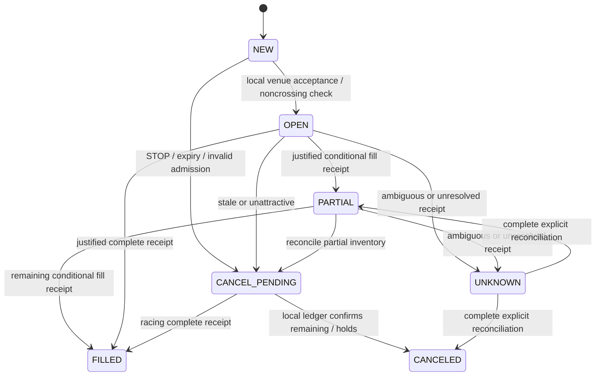

# CoinCat v1.04 — opportunity-driven portfolio shadow

This policy is separate from the unchanged **Native one-leg trial**. It uses
one fictional portfolio with $100 initially in each of BTC, ETH, SOL, LINK and
ADA. Its objective is risk-adjusted total portfolio USD advantage over holding
those original quantities after applicable costs. The original quantities never
become the traded wallet. No account holdings or imported fills fund this trial.

The Native trial remains an optimistic, alternating, fast assumed-fill arithmetic
test. Its interface, rules, wallet, settings and records are unchanged. Its fills
and apparent gains never become execution or profitability evidence here.

## Decisions and costs

Every 30 seconds evaluate all seven approved markets and fourteen directions.
The fixed model uses at least 20 consecutive returns from 21 observations, with
30-second observations and a 20-step forecast horizon. It compares the proposed
portfolio's trailing-return/variance utility with keeping the current inventory,
then subtracts incremental sized future-exit costs and sampling, spread and model
uncertainty allowances. The sampling multiplier is 2.58, the model allowance is
5 basis points and risk aversion is 1. These are declared research assumptions,
not a statistically validated confidence interval or a proven predictive edge.

Only a strictly positive modeled lower bound qualifies. There is no fixed $1 or
one-cent floor, forced ETH return, side alternation or mandatory trade cadence.
Choose the largest positive candidate while preserving funded, unreserved native
inventory and one active order. BTC, ETH, SOL, LINK and ADA can remain inventory.
With no defensible model candidate the decision is HOLD, including for 168 hours.

Use the authenticated maker rate for the projected Post Only leg. Quote-coin
commission and exact proportional precision are explicitly **model assumptions**;
the rate endpoint alone does not prove settlement currency or rounding. Known
replay receipts use their explicit native commission/currency. Unknown units or
amounts prevent settlement credit and require reconciliation. Fee evidence must
bind to the exact same trade, product, side, quantity and price.

Charge one commission exactly once per modeled/replayed filled leg, including
partials. NEW, OPEN, nonfill and cancellation incur no executed trading fee.
Reserve the needed source, but do not deduct a future exit fee from the wallet.
The sized reverse-conversion benchmark uses current depth, native rounding and
the authenticated taker estimate, solely to estimate incremental future exit
cost in the decision. It dispatches no taker order and requires no future exit.
There is no 15% slippage or round-trip surcharge. Estimate uncertainty is shown
separately from paid fees. Missing liquidity, rules, fresh references or rates
produce HOLD/UNKNOWN rather than a claimed positive advantage.

## Resting simulated venue and cancellation

All opportunity orders are **LIMIT GTC Post Only**: BUY at a noncrossing BID,
SELL at a noncrossing ASK, with configurable noncrossing tick improvement in the
policy. Prices, quantities, admission projections and original expiries are fixed
for each child. No resting order is silently edited.



Review every **30 seconds**. At **120 seconds**, also assess whether the fixed
price is more than two native ticks behind its same-side best quote. Retain an
order only while its remaining expected advantage and risk remain acceptable.
Cancel/reconsider an uncompetitive order; cancel without replacement when its
advantage or reliable cost evaluation disappears. There is no losing liquidation.

Default hard limits are **600 seconds per child, 1,800 seconds per opportunity
campaign and three replacements** (four child attempts total). These can be
changed before the first Start within finite validated ranges. Campaign expiry,
initial quantity and native source budget never reset on replacement or restart.
Replacement waits for CANCELED, known cumulative fills, released holds and a
fresh positive evaluation; it cannot reuse already filled size or spent source.
No USD spending cap or dollar profit floor is imposed by this mode. Minimum
native sizes and shared finite fictional funds still apply. Sizing defaults to
minimum; per-market source percentages and the policy freeze on first Start.

The default `TRADE_THROUGH_QUEUE_V1` provider reads at most one active market's
public-trade batch in the existing sixteen-call paced wave. It requires:

- A local accepted order and continuity across public trade-ID windows.
- At least 30 seconds resting, three new strict-through prints spanning at
  least ten seconds, after acceptance and no later than a cancellation request.
- Declared queue ahead of twice visible same-side depth plus own size; only
  10% of new qualifying volume can consume that queue or support a fill.
- No more than 25% of original child size per receipt, rounded to the base
  increment (one increment is the smallest possible fill).

BUY prints must be **below** the limit, SELL prints **above**. A BID/ASK touch,
a candle, a print at the limit, old volume, changed duplicate IDs, an unanchored
window or downtime cannot create a fill. Window gaps reset the queue evidence.
The provider does not infer public aggressor side. `NO_FILL_OBSERVATION_V1` is an
alternative for observing decisions without inferred fills. Explicit simulated
replay receipts remain available for deterministic lifecycle/accounting tests.

These queue, participation and fee-unit assumptions are **uncalibrated**. Even
strict public trade-through does not prove queue priority or that Coinbase would
have filled our order. Results are conditional models, never exchange fills or
validated profitability. Local venue cancellation is its own deterministic ledger
receipt, not an inferred Coinbase cancellation. Explicit ambiguous outcomes stay
UNKNOWN across restart until complete inventory/holds/fill reconciliation.

## Recovery, reporting and protected boundaries

The separate `research_data/opportunity_shadow/active.sqlite3` journal atomically
stores decisions, evidence, original HOLD, inventory, fees, reservations, order
and campaign identities and monotonic clock checkpoints. The existing corrected
trial store and clock are reused without modification. SQL connections/cursors
close explicitly; retained-object regression probes check release before cleanup,
including exclusive native file access on Windows. No GC or retry hides a leak.

Opted-in observation can recover after restart; paused trials stay paused.
Owned local orders are reconciled/canceled before another entry, with no downtime
fills. Explicit UNKNOWN or missing fee evidence blocks resume/replacement. Offline,
paused, suspended, disconnected and partial input periods earn no valid hours.
At 168 valid hours stop new entries, cancel/reconcile the remaining order, freeze
the report and save a private summary. Zero trades is a valid monitoring outcome.
It establishes no trading advantage. No automatic new trial or permission starts.

The private window displays admission and current projected advantage, estimated
future exit cost, native limit/size, original HOLD/current inventory, fill-time
marked changes, native paid fees, cumulative net USD advantage, drawdown, rejected
checks, nonfills, replacements, gaps and uncertainty. Portfolio USD is marked at
current midpoints **after paid modeled fees, before unexecuted exits**. Open losses
remain included; this is not realized or full liquidation value. Stale/unresolved
valuations show UNKNOWN. Detailed receipts remain in the private evidence journal.

The strict optional `opportunity_shadow` diagnostic/monitor extension contains
controlled states, counts, valid seconds and uncertainty labels only. No balances,
prices, dollar values, fees/currencies, IDs, receipts, policy values or private
paths are exported. Monitor routes remain GET-only.

Retirement boundary: retain Native arithmetic and Previous trial records/modules
for their existing modes. Neither is the opportunity selector. No obsolete
automatic controller is reactivated and no private data is migrated or deleted.
Actual submission, grants, session caps, settlement, financial/FIFO/tax/key/import/
lock libraries, dependencies and artwork remain unchanged. Manual live block
still resets ON; deliberate OFF plus manual clicks retains its existing behavior.
The new engine holds only `ShadowAuthorization` and has no SDK write adapter.
**Automatic real-money trading remains disabled.**

## Evidence and Windows acceptance

### Redacted rejection breakdown

The November 9 reporting patch exports `opportunity_shadow.rejection_breakdown`
as a strict optional monitor extension and readable lines in diagnostic section
7/8. It contains fixed labels, fixed reason-code keys and nonnegative integer
counts only. There are no portfolio amounts, prices, quantities, native fee values,
account/order IDs, private paths or raw error strings. Unknown private reason text
maps to `OTHER_UNCLASSIFIED`; missing historical counts are `UNRECORDED_HISTORY`.
Older snapshots without this extension remain readable. Restart the app and local
monitor helper from the new build before collecting a fresh export.

Each rejected direction check contributes one first blocking reason. Fourteen
directions are reviewed repeatedly, including during warmup, so a large rejection
total is not a count of distinct opportunities or exchange order rejections.
The supplied November 9 snapshot has 1,680 reviews / 23,520 rejected checks,
zero qualified checks/orders and about 14.4 valid hours. It reports the old source
manifest but omits the histogram, so those files cannot establish which cause
dominates. A fresh patched export can reuse the locally saved cumulative history.

| Category | Meaning |
| --- | --- |
| Unavailable or unverified data | Missing/stale references, fees, rules or depth; unknown sized future exit estimate |
| Insufficient expected advantage | Existing risk-adjusted advantage after costs is nonpositive even before additional uncertainty allowances |
| Liquidity limitation | Available sized native depth is known to be insufficient |
| Uncertainty | Outlier/invalid risk evidence, or additional existing uncertainty allowances remove an otherwise positive advantage |
| Model warmup | Insufficient observations or a broken observation window |
| Market rules or funding | Native minimum/increment/permission restrictions or insufficient funded, unreserved inventory |
| Spread or crossed book | The existing spread/crossing admission check blocks the proposal |
| Advantage / uncertainty unsplit | Historical combined reason lacks the numeric decomposition needed to attribute it |
| Other or unrecorded | Unknown fixed classification or missing history; never raw text |

Future uncertainty attribution observes the existing projected advantage and its
already computed forecast/model/spread allowances. It does not change a price,
fee, risk weight, threshold, selected candidate, order, cancellation or trading
decision. Future exit estimates remain decision-only, never paid fees. Unknown
future exit cost is reported as unavailable input, not proof of insufficient
liquidity when the old combined reason cannot establish that.

The public report gives total rejected checks, category totals, fixed-code reason
totals and split coverage. Both sets of totals equal the rejected-check counter.
`LEGACY_AGGREGATES_ONLY` uses saved history without modifying a journal;
`SPLIT_SINCE_UPGRADE` preserves that baseline and adds classified future counts;
`COMPLETE_SINCE_TRIAL_START` applies when no pre-split checks exist. Completed
records stay frozen; no trial reset or historical backfill from guessed values.
The Native arithmetic trial and all actual/manual permissions remain unchanged.

The supplied quick diagnostics match the source manifest of `3b6ba12`: roughly
6.5 valid minutes, 35 arithmetic waves, 245 assumed maker orders, zero actual
order attempts/fills and live block ON. This supports the connected arithmetic
labels, not realistic execution or a full native Windows source-suite pass.
No private uploaded session data is included in the release.

`verification/opportunity_scenarios.py` runs six fixed chronological synthetic
paths with the same original $500 portfolio. A 5% source sizing configuration is
declared for the scenarios; application defaults remain minimum. Synthetic fees
are 0.5% maker and 0.9% future-exit estimate, with 4% in the high-fee scenario.
Every path retains rejected checks, misses, costs, residual holdings and losses:

| Fixed path | Orders | Fill events | Paid fees USD | Net modeled USD vs HOLD |
| --- | ---: | ---: | ---: | ---: |
| Flat, no edge | 0 | 0 | 0 | 0 |
| Trend, no fills | 9 | 0 | 0 | 0 |
| Trend, conditional print model | 11 | 30 | 0.163429 | +0.523778 |
| Reversal, conditional print model | 5 | 13 | 0.075120 | -1.262920 |
| High fees, no edge | 0 | 0 | 0 | 0 |
| Trade gap and restart | 7 | 23 | 0.122715 | +0.495071 |

These are engineering scenarios, not historical backtests, tuned performance
claims or calibrated fill evidence. The reversal loses despite a positive prior
forecast. Reproduce the complete CSV/JSON comparison outside the checkout with:

```bat
.venv\Scripts\python.exe verification\opportunity_scenarios.py --output ..\CoinCat_Opportunity_Evidence
```

1. Extract the new source into a separate folder. Preserve installed data/backups.
   Run `02_SETUP_COINCAT.bat`, `tools\VERIFY_OPPORTUNITY_SHADOW.bat`, then the full
   `03_VERIFY_COINCAT.bat`. Require zero failures/errors. The known host-symlink
   capability skip may remain; Windows native file-handle probes must pass.
2. Launch `01_START_COINCAT.bat` with **Live orders blocked ON**, connect and open
   **Opportunity shadow…**. Start the default minimum policy. Allow at least ten
   valid minutes for 21 prospective observations. Fourteen HOLD rows and no
   order are expected when costs or uncertainty exceed the modeled advantage.
3. Inspect native limits, projections, OPEN/PARTIAL/nonfill/cancel states and
   Portfolio / evidence. Touching price must not guarantee a fill. Review cadence
   is not a trade cadence. Missing public trades must never produce a fill.
4. Test Pause, tray, Exit safely, restart and a disconnected interval. Preserve
   trial identity, original HOLD, wallet, native fees and valid hours. Check
   finite cancellation/retry behavior and no downtime execution.
5. Confirm the Native arithmetic window remains separate, with its existing
   ASK/BID choice and sizing. Diagnostics/monitor show separate aggregate counts.
   Keep detailed private evidence local. Native Windows/connected endpoints,
   real maker-fill calibration and a full 168-hour observation remain local work.
