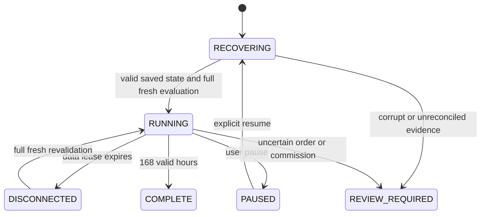

# v1.04 persistent shadow trial

The objective is risk-adjusted total portfolio USD value, net modeled costs,
versus the original five-asset HOLD portfolio. Native inventory may stay in BTC,
ETH, SOL, LINK or ADA. No ETH-cycle, one-cent trigger, forced two-minute trade,
automatic loss liquidation or automatic real-order grant is active here.

## Persistence and recovery

`research_data/resumable_trial/active.sqlite3` is separate from financial and
manual journals. Application ID `0x43435434`, user version 104, model schema 2
and clock schema 1 are checked before use. `trial_state` holds the frozen
strategy/config digest, original trial UUID/start/deadline, hypothetical wallet,
original native HOLD quantities, original venue holds, attempts/reservations,
replay identities/native fees, bounded risk observations and performance state.
`trial_clock` holds integer nanosecond counters, run identity, monotonic high
water, quality lease, last UTC checkpoint, opt-in/pause flag and completion.
Both rows are hashed. `trial_events` preserves decision frames and replay
receipts; each model event and current clock commit in one SQLite transaction.
Clock-only updates replace one row every five seconds without per-second logs.

A crash can lose progress since the last successful checkpoint; it cannot add
unobserved time. There is no claim to recover an unwritten final second. SQLite
transactions, revision checks and idempotent event fingerprints reject stale
writers and conflicting duplicate events. Handles close after every operation.
Corruption, incomplete tables, version/digest/identity conflicts preserve the
file and display REVIEW_REQUIRED. No fallback initializes a clean replacement.
The storage bound is 1 GiB; reaching it requests review rather than deleting data.

A new run restores the original model, adds the interval since the last durable
UTC checkpoint to downtime, increments restart/unclean-interruption counts and
invalidates old feed leases. An opted-in shadow trial refreshes using the saved
local key, then validates the native universe and fees before resuming. Paused
trials remain paused. Dispatched replay orders, unknown results and unresolved
commissions require explicit reconciliation. No downtime candles produce fills.
Manual real-order blocking always resets ON independently.

## Time and feed validity

Target: 604800 seconds / 168 valid hours. A monotonic interval counts only with
validated quality at both endpoints, seven native markets, fresh ETH-USD
valuation, authenticated maker estimates, current native rules and active
strategy evaluation. Duplicates add zero; reversed/overlapping monotonic input
requires review; a checkpoint gap over 45 seconds is unobserved downtime. Market
leases expire conservatively after 25 seconds. Pauses, missing/stale feeds and
partial coverage add zero full-market hours. Coverage-weighted time, partial,
paused, disconnected and offline durations remain separate.

UTC clock changes never earn or remove valid hours. A detected wall/monotonic
disagreement marks calendar/downtime estimates uncertain and blocks new intents;
monotonic validated observations may continue. DST affects local display only.
The deterministic acceptance case is **6 valid + 10 offline + 4 valid = 10 h**.
Multi-day gaps and multiple interrupted sessions reach exactly 168, then freeze.

The collector has a separate metadata-priming wave, then reads all seven native
books plus the ETH-USD valuation reference within 16 paced GET calls. No rotating
six-book scan masquerades as full coverage. A 12-second decision span and native
quote validation remain required. Wide trustworthy books can be observed while
trading admission still HOLDs at the existing 0.25% spread limit. Metadata renewal
and fee outages can create honest gaps. Fee failures wait at least ten minutes
before retry; authenticated fees refresh hourly. The original shared GET budget
and manual request bounds remain unchanged.

## Strategy and lifecycle

Frozen policy `RISK_ADJUSTED_USD_PORTFOLIO_SHADOW_V1` ranks fourteen native
directions deterministically using current funded inventory, native maker
receipts, trailing returns/covariance, portfolio volatility, forecast uncertainty
and spread costs. At least twenty contiguous return observations are required;
gaps restart warm-up. A candidate needs positive risk-adjusted utility after
fees and uncertainty. This is an unvalidated hypothesis, not a demonstrated edge.
Sized opposite depth is a conservative admission screen, never queue/fill proof.
A projected quote-denominated fee model is explicitly conditional and never
asserts an exchange commission currency. Native minima/rounding and residual
holdings remain in the full portfolio. No trade is required at a review time.

Default shadow limits: $5/order, $10 cumulative turnover, four lifetime proposal
attempts, 50% of free source, one open order, fixed 30-day intent deadline.
Hitting the attempt/capital/deadline bound continues observation/HOLD without
minting a new budget. Manual real-order limits remain their existing 30-minute
limits. Neither restart nor reprice extends any deadline or increases a root
order's original native size/source budget. Every replacement consumes a slot.

Order states are local RESERVED, explicit replay UNKNOWN/SIMULATED_OPEN/PARTIAL,
CANCEL_PENDING and reconciled FILLED/CANCELED/REJECTED. Local undispatched
proposals have known zero fills and can be retired. After replay dispatch, a
cancel acknowledgement alone releases nothing: native filled quantity, all fill
identities, exact inventory, terminal status and released order hold must agree.
Unknown POST is never retried. Missing fee currency locks settlement; an explicit
fee-evidence event can resolve it without altering original quantity/price/fee.
Partial proceeds cannot fund another order before reconciliation. Known adverse fee overruns are accounted and flagged for review, never erased
to manufacture a qualifying outcome. A fee buffer reserves possible source-asset
commission without double charging it. Native fees
are charged once in their supplied currencies, including third-asset fees.

The connected provider currently proposes hypotheses and assumes **no inferred
maker fills**. Only explicitly labeled replay receipts advance hypothetical
inventory. Price touch, market-through, candles and downtime are not queue proof.
A real-time probabilistic maker model is not calibrated by one historical fill
and is not included. Report proposal, unfilled, replay-filled and canceled counts
separately; a quiet trial cannot claim execution quality or predictive success.

## Performance and privacy

Starting valuation is frozen at the first full validated market frame. Current
hypothetical and original HOLD quantities use identical current USD marks.
Dollar/percentage changes, versus-HOLD differences, exposures, marked drawdown,
open native inventory and modeled native fees remain visible privately.
Observed actual account changes are separately classified and never alter the
shadow wallet/benchmark. Actual imported commissions are a separate history
summary; unknown currencies are never summed as though they were one asset.

A marked gain is not realized profit or trading edge. Liquidation value remains
UNKNOWN without complete native USD exit rules, sized depth and fee-unit evidence.
For untraded inventory, unrealized change is measured from trial inception, not
from tax acquisition basis. After modeled conversions, open lot P/L remains
UNKNOWN where complete lot basis is not established;
whole-portfolio marked change remains visible. These unknowns cannot qualify
profit or authorize real execution. A future acceptance patch must close those
accounting gaps before a live pilot. The final summary preserves these limits.

The optional monitor-v3 `shadow_trial` extension exports only strict states,
counts, valid seconds, restart count and coverage percentage. No quantities,
valuations, UUIDs, raw receipts or private paths leave the local dashboard.

## Tray and completion

The Windows native ctypes tray owns no trading permission. Open/status,
pause/resume, progress, private performance and Exit safely are separate actions.
Window close/minimize hides while monitoring continues; pause stops valid time;
Exit checkpoints; shutdown is never vetoed. Existing single-instance protection
remains. Explorer restart re-adds the icon or opens the window. If tray support
is unavailable, an active trial cannot be accidentally hidden and forgotten.

At 168 hours the clock freezes, the model becomes COMPLETE and a private JSON
summary is written beside the trial database. No new trial, budget, order or
live permission is started automatically. Real Win32 tray/DPAPI/shutdown,
connected Coinbase permissions/fees/identity/cancel/holds, ambiguous requests
and actual multi-day monitoring require local acceptance. Offline fixtures are
not a completed live observation trial and do not predict future returns.
